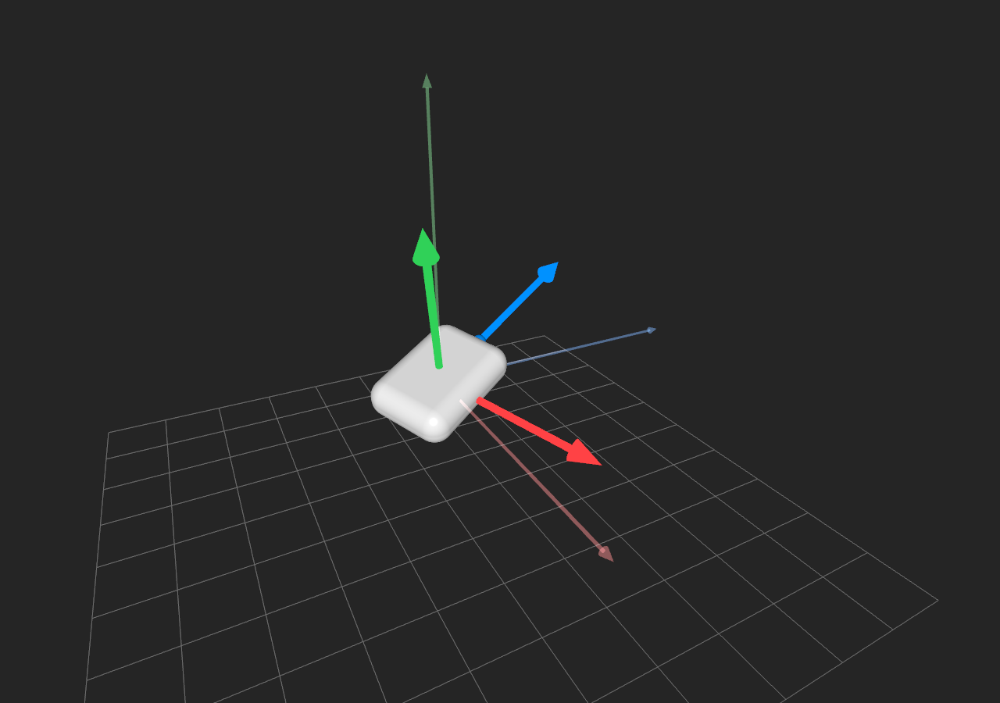

<div align="center">

# 🎧🖱️ AirPodsMouse

**Turn your AirPods case into an air mouse.**

Open the lid, point the case at your screen, and steer the cursor with a flick of your wrist.<br>
No extra hardware: it uses the motion sensors built into the AirPods sitting in the case.




<sub><i>The built-in 3D viewer: the case and its axes follow your hand in real time.</i></sub>

</div>

---

## ✨ Features

- 🎯 **Air pointing**: rotate the case left/right and up/down to move the cursor
- 🔄 **Wrist-twist click**: twist the case like a key to **left-click**
- ⚡ **Flick click**: a quick up/down flick to **right-click** (optional)
- 🧭 **Works in any grip**: horizontal motion is computed from gravity, so it doesn't matter how the earbuds lie in the case
- 🎚️ **3-second calibration** for the vertical axis, saved between launches
- 🧊 **Live 3D viewer** showing the case orientation, its axes, and click feedback
- 🫨 **Dead zone + smoothing + acceleration** to cancel hand jitter and keep pointing precise
- ⌨️ **Global hotkeys** so you can always take back control
- 🪶 **Menu bar app**: no Dock icon, no window unless you ask for one

## 📋 Requirements

| | |
|---|---|
| **Mac** | macOS 14 Sonoma or later |
| **AirPods** | Models with motion sensors: **AirPods Pro (1 & 2)**, **AirPods 3 / 4**, **AirPods Max** |
| **Tools** | Xcode Command Line Tools (`xcode-select --install`) |

> [!NOTE]
> AirPods 1st and 2nd gen have no gyroscope and won't work.

## 🚀 Getting started

```bash
git clone https://github.com/Harlo9/AirPodsMouse.git
cd AirPodsMouse
./build.sh
open AirPodsMouse.app
```

Then:

1. **Disable ear detection**: *System Settings → [your AirPods] → Automatic Ear Detection → Off*
2. **Open the case lid** and make sure the AirPods are connected to your Mac
3. Allow **Motion & Fitness** access when prompted
4. Allow **Accessibility** access: *System Settings → Privacy & Security → Accessibility → AirPodsMouse*
5. Look for **🎧🖱** in the menu bar. You're live.

> [!TIP]
> After rebuilding, macOS may forget the Accessibility permission. Remove AirPodsMouse from the list with **−**, add it again, and relaunch.

## 🎯 Calibrate

Press **`⌃ ⌥ C`**, then within 3 seconds:

> Point the case at the screen → **tilt it UP** and back, 2–3 times

A *Glass* sound confirms it. The calibration is saved, so you only do this once.

## 🎮 Controls

### Gestures

| Gesture | Action |
|---|---|
| ↔️ Rotate the case left / right | Move cursor horizontally |
| ↕️ Tilt the case up / down | Move cursor vertically |
| 🔄 Quick **twist** (like turning a key) and back | **Left click** |
| ⚡ Quick **flick** up/down and back | **Right click** *(enable in menu)* |

The cursor freezes during a gesture, so clicks land exactly where you aimed.

### Hotkeys

| Shortcut | Action |
|---|---|
| `⌃ ⌥ Q` | Quit |
| `⌃ ⌥ P` | Pause / resume |
| `⌃ ⌥ C` | Calibrate |
| `⌃ ⌥ V` | Open the 3D viewer |

### Menu bar

Click **🎧🖱** to recalibrate, invert axes, toggle each click gesture, adjust sensitivity, or open the 3D view. *(The app UI is currently in French.)*

## 🧊 3D viewer

Open it with **`⌃ ⌥ V`** (or launch with `open AirPodsMouse.app --args --3d`).

| Element | Meaning |
|---|---|
| 🔴 Red arrow | Case's **right** axis |
| 🟢 Green arrow | Case's **up** axis |
| 🔵 Blue arrow / dot | Where the case is **pointing** |
| Thin arrows | Fixed world reference |
| Case flashes 🔵 / 🟠 | Left / right click detected |

Drag to orbit the camera, scroll to zoom, and hit **Recentrer** to reset.

> [!TIP]
> Press `⌃ ⌥ P` to pause cursor control while you play with the 3D view.

## 🧠 How it works

```
 AirPods (in open case)
        │  CMHeadphoneMotionManager  (~25 Hz: attitude, rotation rate, gravity)
        ▼
 ┌──────────────────────────────────────────────┐
 │  ω = gyroscope rotation rate (earbud frame)    │
 │  g = gravity direction       (earbud frame)    │
 │                                                │
 │  horizontal speed = −ω · g        (no calib.)  │
 │  vertical speed   =  ω · a        (a learned)  │
 │  twist speed      =  ω · (a × g)  (pointing)   │
 └──────────────────────────────────────────────┘
        │  dead zone → acceleration curve → smoothing
        ▼
   CGEvent mouse move / click
```

- **Horizontal** is the rotation around the vertical, which gravity gives directly, so it's independent of how the earbuds sit in the case.
- **Vertical axis `a`** is learned in calibration with a principal-component analysis of your up/down tilts. The sign comes from the direction of the first tilt.
- **Pointing axis** is perpendicular to both, so the twist gesture needs no extra calibration.
- Motion is **relative** (velocity-based, like a real mouse), so there's no drift to fight and the trackpad keeps working alongside it.

## 🗂️ Project structure

```
AirPodsMouse/
├── main.swift       # Motion processing, gestures, menu bar, hotkeys
├── Viewer3D.swift   # SceneKit live 3D viewer
├── build.sh         # Builds & signs AirPodsMouse.app
└── docs/
    └── 3d-view.png
```

## 🛠️ Troubleshooting

| Problem | Fix |
|---|---|
| Cursor doesn't move | Re-grant **Accessibility** permission (see tip above) |
| Status stuck on *waiting for AirPods* | Disable ear detection, keep the lid **open**, check the Bluetooth connection |
| Up/down is reversed | Menu → **Inverser haut/bas** (invert up/down) |
| Too fast / too slow | Menu → **Sensibilité + / −** (sensitivity) |
| Clicks trigger too easily | Raise the `threshold` of `twist` / `flick` in `main.swift` |
| Cursor goes wild | Recalibrate with `⌃ ⌥ C` |

---

<div align="center">

Made with 🎧 and way too much wrist-twisting.

</div>
