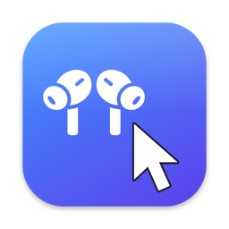
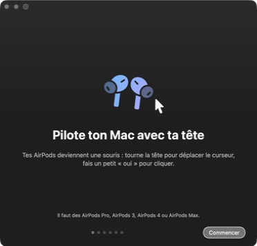
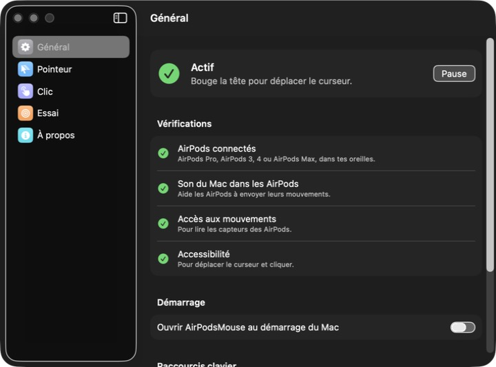
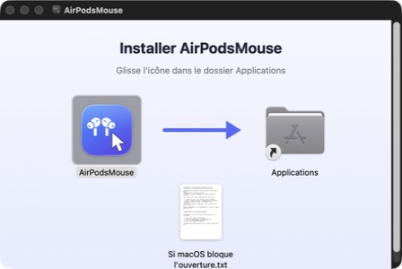

<div align="center">



# AirPodsMouse

### Pilote ton Mac avec ta tête, grâce à tes AirPods.

Tourne la tête pour déplacer le curseur. Fais un petit « oui » pour cliquer.<br>
Aucun matériel en plus : l'appli lit les capteurs de mouvement de tes AirPods.


[**Installer**](#-installer) · [**Utiliser**](#-utiliser) · [**Problèmes**](#-en-cas-de-problème) · [**English**](#-english) · [**Développeurs**](#-développeurs)

</div>

---

## ✨ Ce que fait AirPodsMouse

| | |
|---|---|
| 🎯 **Viser avec la tête** | Un petit angle suffit : environ 10° à gauche ou à droite pour traverser l'écran. Précis quand tu bouges lentement, rapide quand tu bouges vite. |
| 🙂 **Cliquer par hochement** | Un petit « oui » rapide = un clic. Deux de suite = double-clic. Un vrai regard vers le haut ou le bas ne clique pas. |
| ⏱️ **Clic automatique** | Pour qui ne peut pas faire de geste rapide : garde le curseur immobile une seconde sur une cible, un anneau se remplit, puis ça clique. |
| ↘️ **Clic droit** *(option)* | Penche vite la tête vers une épaule et reviens. |
| 🧭 **Toujours aligné** | En face de l'écran, le curseur revient au centre, même après avoir regardé au-delà d'un bord. L'appli se recale toute seule. |
| ↕️ **Défiler avec la tige** *(option)* | Glisse le doigt vers le haut ou le bas sur la tige des AirPods Pro 2. |
| 📜 **Défiler avec la tête** | ⌃⌥S, puis penche la tête vers le haut ou le bas ; un hochement pour arrêter. |
| ✊ **Glisser-déposer** | ⌃⌥D pour attraper (sélectionner du texte, déplacer une fenêtre ou un fichier), un hochement pour lâcher. |
| 🎯 **Menu de clic rapide** *(option)* | Avec le clic automatique : un menu circulaire (clic, double-clic, clic droit, glisser, défiler) ; vise l'action et reste immobile. |
| 🧲 **Aimant** | Le curseur ralentit au-dessus des boutons et des liens : plus facile de viser. |
| ⌨️ **Pause pendant la frappe** | Quand tu tapes (et regardes le clavier), le curseur reste en place. |
| 🙅 **« Non » = Échap** *(option)* | Secouer la tête ferme un menu ou annule. |
| 🗣️ **Écrire sans les mains** | Accès direct à la dictée et au réglage du clavier visuel de macOS. |
| 🧭 **Accueil guidé** | Au premier lancement, l'appli t'accompagne pas à pas jusqu'au premier clic réussi. |
| 🎚️ **Réglages clairs** | Vitesse, sensibilité du clic, délai du clic automatique, ouverture au démarrage… |
| 🔒 **Tout reste sur ton Mac** | Aucune donnée n'est envoyée nulle part. |

<div align="center">
 &nbsp; 
</div>

## 📋 Il te faut

- Un Mac avec **macOS 14 Sonoma** ou plus récent (Apple Silicon ou Intel).
- Des **AirPods Pro** (1, 2 ou 3), **AirPods 3**, **AirPods 4** ou **AirPods Max**.
  Les AirPods 1 et 2 n'ont pas de capteurs de mouvement et ne fonctionnent pas.

## 📦 Installer

1. Télécharge **`AirPodsMouse-2.0.dmg`** depuis la page [Releases](../../releases).
2. Ouvre-le et **glisse AirPodsMouse dans le dossier Applications**.

   

3. Ouvre AirPodsMouse depuis Applications (ou tape « AirPodsMouse » dans Spotlight, ⌘ Espace).

> [!NOTE]
> **Si macOS bloque la première ouverture** (« Apple ne peut pas vérifier… ») : c'est normal, l'appli est gratuite
> et pas encore vérifiée par Apple. Va dans **Réglages Système › Confidentialité et sécurité**, descends jusqu'à
> « AirPodsMouse a été bloquée » et clique **Ouvrir quand même**. Il ne faut le faire qu'une fois.
> Le détail est dans le fichier « Si macOS bloque l'ouverture » du `.dmg`.

4. **L'accueil fait le reste** : il te demande d'autoriser l'accès aux mouvements et l'Accessibilité
   (nécessaire pour déplacer le curseur), vérifie que tes AirPods bougent, puis te propose un petit essai.

## 🎮 Utiliser

| Geste | Action |
|---|---|
| Tourner la tête à gauche / à droite | Déplacer le curseur horizontalement |
| Lever / baisser la tête | Déplacer le curseur verticalement |
| Petit « oui » rapide (baisser et revenir) | **Clic** — deux de suite : **double-clic** |
| Rester immobile ~1 s *(si activé)* | **Clic automatique** |
| Pencher vite vers une épaule *(si activé)* | **Clic droit** |
| Glisser haut / bas sur la tige *(si activé)* | **Défiler** — plusieurs glissements rapprochés vont plus loin |
| Secouer la tête « non » *(si activé)* | **Échap** |

| Raccourci | Action |
|---|---|
| `⌃ ⌥ P` | Pause / reprendre |
| `⌃ ⌥ V` | Ouvrir les réglages |
| `⌃ ⌥ C` | Recentrer (regarde le centre de l'écran, puis appuie) |
| `⌃ ⌥ D` | Glisser-déposer : attraper / lâcher |
| `⌃ ⌥ S` | Défiler avec la tête (marche / arrêt) |
| `⌃ ⌥ Q` | Quitter |

L'icône **AirPods** de la barre des menus donne l'état et les options rapides. Sur un MacBook à encoche, elle
peut être cachée quand la barre est pleine : **double-clique sur AirPodsMouse** (Applications ou Spotlight) pour
ouvrir les réglages à tout moment.

## 🛠️ En cas de problème

| Problème | Solution |
|---|---|
| « Aucun mouvement reçu » | Mets les AirPods dans tes oreilles. S'ils y sont déjà, ils sont sans doute **passés sur ton iPhone** : clique **« Ramener les AirPods sur ce Mac »** (réglages ou menu), ou choisis-les dans le menu Son. |
| Le curseur ne bouge pas | Réglages › Général : vérifie que **Accessibilité** est cochée. Sinon clique « Ouvrir le réglage » et active AirPodsMouse. |
| Trop rapide / trop lent | Réglages › Pointeur › **Vitesse**. |
| Clics involontaires | Réglages › Clic › Sensibilité **Prudent**. |
| Le clic ne part pas | Réglages › Clic › Sensibilité **Facile**, ou active le **clic automatique**. |
| Le curseur part en diagonale | Réglages › Pointeur › **Calibrer…**, ou **Réinitialiser**. |
| Le curseur n'est plus en face | Regarde le centre de l'écran et appuie sur **⌃⌥C**. |
| Plus aucun mouvement, AirPods sur les oreilles | Coupe puis rallume le **Bluetooth** (Centre de contrôle) : le service des capteurs de macOS reste parfois bloqué. |
| Glisser sur la tige ne défile pas | Réglages › Clic › **Défiler avec la tige** ; les AirPods doivent être la sortie audio (AirPods Pro 2). |

Le journal (Réglages › À propos › Ouvrir le journal) note l'état et chaque clic : utile pour signaler un problème.

---

## 🇬🇧 English

**AirPodsMouse turns your AirPods into a head mouse.** Turn your head to move the pointer, give a small quick nod to
click (two nods = double-click), or enable **dwell click** (hold still ~1 s on a target). The app is fully localized
in English (it follows your Mac's language).

1. Download `AirPodsMouse-2.0.dmg` from [Releases](../../releases) and drag the app to Applications.
2. If macOS blocks the first launch: System Settings › Privacy & Security › **Open Anyway** (once).
3. The welcome screens walk you through Motion access, Accessibility, and a short practice.

Requires macOS 14+ and AirPods Pro, AirPods 3/4 or AirPods Max. No data ever leaves your Mac.

---

## 👩‍💻 Développeurs

Projet Swift Package (outils en ligne de commande suffisants, pas besoin de Xcode).

```
Sources/
├── AirPodsMouseCore/     # Logique pure, testée : moteur de pointage, gestes, clic automatique, rejeu
├── AirPodsMouse/         # L'appli : SwiftUI (accueil, réglages, menu) + capteurs, curseur, autorisations
└── AirPodsMouseChecks/   # Vérifications automatiques (rejouent de vrais enregistrements de capteurs)
Resources/                # Icône, traductions (fr, en)
scripts/                  # build-app.sh, make-dmg.sh, make-icon.swift, check-strings.sh
Tests/Fixtures/           # Enregistrements réels des capteurs (CSV)
```

```bash
swift run AirPodsMouseChecks      # vérifications (moteur, clics, clic automatique)
scripts/build-app.sh              # appli universelle signée, installée dans /Applications
scripts/make-dmg.sh               # dist/AirPodsMouse-<version>.dmg
```

**Comment ça marche.** Les rotations des AirPods sont décomposées avec la gravité : le lacet (gauche/droite) ne
dépend pas de la façon dont les écouteurs sont portés ; le tangage (haut/bas) suit un axe par défaut ou calibré.
Un filtre « 1 € » lisse le tremblement à   sse vitesse sans retard à haute vitesse, et le gain dépend de la vitesse.
Les capteurs envoient ~50 mesures/s par paquets Bluetooth : la sortie est lissée à 120 Hz. Un clic = un aller-retour
court (3–17°) et rapide (< 0,5 s) qui revient au point de départ ; les seuils viennent d'enregistrements réels
(`Tests/Fixtures`), rejoués à chaque vérification.

**Signature.** `build-app.sh` signe avec l'identité « AirPodsMouse Dev » si elle existe (l'autorisation
Accessibilité reste valable d'une version à l'autre), sinon en ad-hoc.
